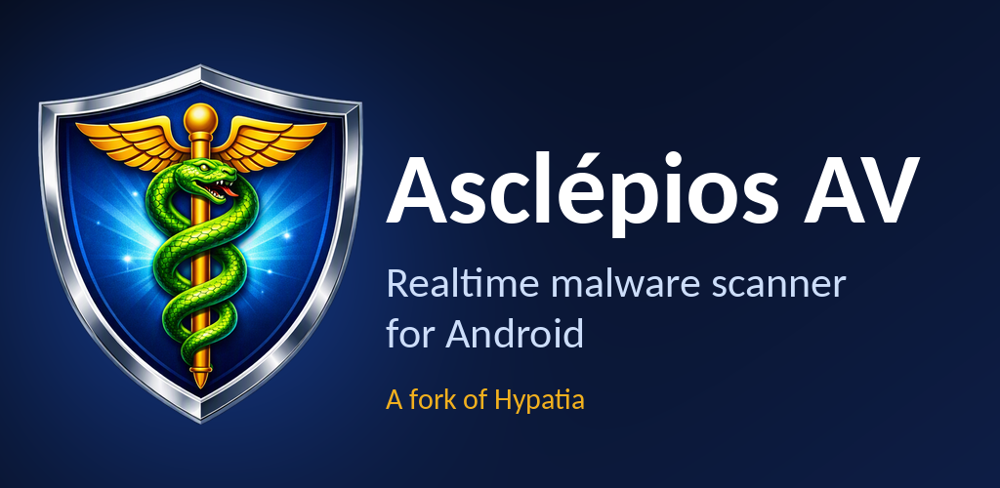

> [!WARNING]
> ### Ceci est un fork de l'application [originale](https://github.com/Divested-Mobile/Hypatia) (abandonnée) de DivestOS.



Hypatia
=======

Vue d'ensemble
--------------
Hypatia est le premier scanner de logiciels malveillants FOSS (logiciel libre) au monde pour Android. Il est propulsé par des bases de données de signatures de style ClamAV.

[](https://apt.izzysoft.de/packages/org.maintainteam.hypatia/)
[](https://hosted.weblate.org/projects/maintainteam/hypatia/)

Caractéristiques
----------------
- Impact quasi nul sur la batterie : vous ne remarquerez aucun effet sur l'autonomie
- Extrêmement rapide : il peut analyser de petits fichiers (1 Mo) en moins de 20 ms, et même de gros fichiers (40 Mo) en 1000 ms
- Économe en mémoire : avec les bases de données par défaut, il utilise moins de 120 Mo
- Analyse manuelle : permet de sélectionner /system, le stockage interne, le stockage externe et les applications installées
- Scanner en temps réel : détecte les logiciels malveillants à l'écriture ou au renommage de fichiers dans le stockage interne
- Entièrement hors ligne : Internet n'est utilisé que pour télécharger les bases de signatures, les fichiers ne quittent jamais votre appareil
- Mises à jour automatiques optionnelles des bases : une fois par jour, en Wi-Fi uniquement, avec téléchargement seulement si le serveur a un fichier plus récent (HTTP 304)
- Persistance : redémarre automatiquement au démarrage et après une mise à jour
- Code source minuscule : il peut être audité même par quelqu'un ayant une expérience de base en programmation
- Dépendances minimales : l'application n'utilise des bibliothèques que lorsque c'est nécessaire
- Les bases de signatures peuvent être activées ou désactivées à la demande de l'utilisateur


Dépannage
---------
- **L'application plante et est très instable :**
Vérifiez d'abord si les bases de données étendues sont activées. Elles nécessitent davantage de RAM (8 Go) et peuvent parfois rendre l'application très instable.
- **Impossible de télécharger les bases de données :**
Appuyez sur les trois points en haut à droite de l'écran principal, puis sur `Remplacer le serveur de base de données`. Cela permet d'utiliser un miroir si le serveur principal est indisponible.
- **Il y a des faux positifs :**
Cela arrive occasionnellement en raison de la nature des filtres de Bloom. Si vous pensez avoir un faux positif, relancez d'abord l'analyse, ce qui le corrige parfois. S'il persiste, envoyez le fichier à [VirusTotal](https://www.virustotal.com/gui/home/upload) : il vous dira s'il s'agit réellement d'un faux positif ou d'un logiciel malveillant.

Informations sur l'APK et sécurité
----------------------------------

Les versions debug, release et nightly sont compilées par GitHub Actions. Vous pouvez comparer la somme de contrôle de l'application avec celle indiquée dans les Release Actions ou dans le fichier checksum.txt des publications.

Voici l'empreinte SHA de la clé de signature d'Hypatia, qui permet de vérifier les APK téléchargés et signés par nos soins :
```
1B:00:8D:64:BB:95:AB:47:74:D6:8B:87:F2:2B:8B:E9:A2:72:F4:92:4D:F5:20:29:D7:E6:18:38:35:D9:18:CC
```

Détails techniques
------------------
- Les bases de signatures sont au format de sérialisation d'objet BloomFilter de Guava
- Les bases de signatures ne sont pas retéléchargées si le fichier n'a pas changé sur le serveur (304 Not Modified)
- Une tâche JobScheduler quotidienne optionnelle (Wi-Fi / connexion non facturée uniquement) vérifie la présence de bases plus récentes et les télécharge
- Les signatures sont stockées dans des BloomFilters pour une recherche en O(k)
- Les hachages MD5, SHA-1 et SHA-256 des fichiers sont calculés en un seul passage
- Le scanner en temps réel est multitâche et utilise la moitié du nombre de cœurs de l'appareil pour analyser plusieurs fichiers de manière asynchrone
- L'analyse en temps réel repose sur un FileObserver récursif
- Les analyses et les téléchargements s'exécutent sur un pool de threads dédié (sans `AsyncTask`, déprécié) ; les journaux et notifications sont toujours émis depuis le thread principal

Autorisations
-------------
- `ACCESS_NETWORK_STATE` : vérifie si un réseau est disponible avant de mettre à jour les bases.
- `FOREGROUND_SERVICE` et `FOREGROUND_SERVICE_SPECIAL_USE` : utilisées pour l'analyse en temps réel.
- `INTERNET` : télécharger et mettre à jour les bases de données.
- `MANAGE_EXTERNAL_STORAGE` : lire les fichiers malveillants pour les analyser et supprimer les fichiers infectés.
- `WRITE_EXTERNAL_STORAGE` et `READ_EXTERNAL_STORAGE` : analyser et supprimer les fichiers infectés sur les anciennes versions d'Android.
- `QUERY_ALL_PACKAGES` : analyser les applications malveillantes.
- `RECEIVE_BOOT_COMPLETED` : relancer l'application au redémarrage.
- `REQUEST_DELETE_PACKAGES` : désinstaller les applications infectées.
- `POST_NOTIFICATIONS` : afficher les notifications.
- `WAKE_LOCK` : garde le téléphone éveillé pendant l'analyse pour éviter que le processus ne soit tué.
- `ACCESIBILITY_SERVICE` : permet à l'analyseur de liens de lire l'écran et de détecter les domaines malveillants.
- `DYNAMIC_RECEIVER_NOT_EXPORTED_PERMISSION` : requise par Android pour la déclaration des récepteurs.

Compilation
-----------
Compiler l'application est similaire à la plupart des applications Android, mais pour synchroniser le projet dans Android Studio, vous devrez peut-être ajouter ce qui suit à [verification-metadata.xml](https://github.com/MaintainTeam/Hypatia/blob/stable/gradle/verification-metadata.xml) :
```xml
      <trusted-artifacts>
         <trust file=".*-javadoc[.]jar" regex="true"/>
         <trust file=".*-sources[.]jar" regex="true"/>
      </trusted-artifacts>
```

Mises à jour prévues
--------------------
Pour consulter la feuille de route immédiate, regardez les [jalons](https://github.com/MaintainTeam/Hypatia/milestones) : vous pourrez ainsi estimer le délai avant la prochaine version. 😀
- Option d'analyse à l'accès
- Analyse des applications nouvellement installées ou mises à jour
- Option permettant aux applications tierces de lancer des analyses
- Mises à jour automatiques des bases de données
- Vérifications de cohérence des bases de données
- Tests
- Meilleure interface graphique
- Traductions
- Analyse de tout le système avec root (faible priorité)

Objectifs
---------
- Être rapide
- Ne pas vider la batterie
- Utiliser un minimum d'autorisations
- N'utiliser des bibliothèques que lorsque c'est nécessaire

Crédits
-------
- ClamAV pour les bases de données (GPLv2)
- ESET pour des bases de données supplémentaires (BSD 2-Clause)
- Nex (@botherder) pour des bases de données supplémentaires (CC BY-SA 4.0)
- Amnesty International pour des bases de données supplémentaires (CC BY 2.0)
- Echap pour des bases de données supplémentaires (CC BY 4.0)
- MalwareBazaar pour des bases de données supplémentaires (CC0)
- RecursiveFileObserver.java (GPL-3.0-or-later) : Daniel Gultsch, ownCloud Inc., Bartek Przybylski
- GPGDetachedSignatureVerifier.java (GPL-2.0-or-later) : Federico Fissore, Arduino LLC
- Petra Mirelli pour la bannière / le graphique de présentation de l'application et divers ajustements
- @eloitor : travail sur les traductions
- Icônes : Google/Android/AOSP, licence : Apache 2.0, https://google.github.io/material-design-icons/

Traductions
-----------
- Afrikaans : Oswald van Ginkel
- Arabe : abdelbasset jabrane, ABDO GM
- Chinois (simplifié) : Sdarfeesh, Crit, 大王叫我来巡山
- Chinois (traditionnel) : 張可揚
- Croate : lukapiplica
- Tchèque : Fjuro
- Estonien : Priit Jõerüüt
- Finnois : huuhaa, Ricky Tigg
- Français : cardpuncher, Jean-Luc Tibaux, Petra Mirelli, thraex
- Hébreu : elid34
- Galicien : ghose, josé m
- Allemand : thereisnoanderson, Balthazar1234, Petra Mirelli, Ettore Atalan
- Grec : Dimitris Vagiakakos
- Indonésien : Adrien N
- Italien : Tommaso Fonda, srccrow, Petra Mirelli, Dark Space
- Japonais : honyaku
- Polonais : Marcin Mikołajczak
- Portugais (Brésil) : lucasmz
- Portugais : jontaix, inkhorn, ssantos
- Roumain : Renko
- Russe : yurtpage, q1011, Andrey
- Slovaque : Pa Di
- Espagnol : gallegonovato, Manuel-Senpai, Petra Mirelli
- Turc : cardpuncher
- Ukrainien : Fqwe1

Avis
----
- Divested Computing Group n'est pas affilié à Cisco ou à ESET
- MaintainTeam n'est pas affilié à Cisco ou à ESET
- Hypatia n'est pas sponsorisé ni approuvé par Cisco ou ESET
